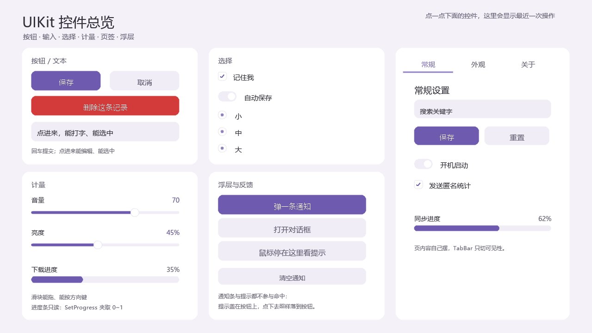
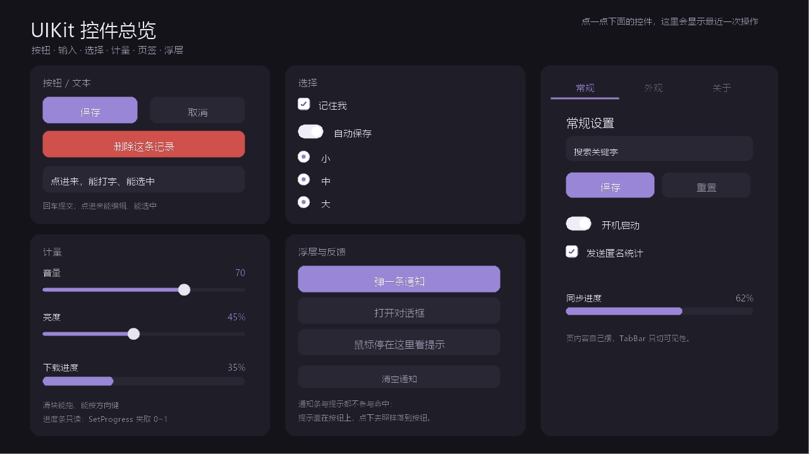

# InkingFrontendDeveloper

**一个用 SDF 形状 + 锚点定位写 UI 的 C++20 前端框架（动态链接库）。**

> ## ✅ 当前版本：**1.0.0 预览版**（`1.0.0-preview`）
>
> - **预览版 ≠ 冻结**：功能面已按 1.0 收齐、可整包交付评估，但**公开面盘点**
>   （哪些符号是承诺、哪些可改）还没做完，接口 / ABI 仍可能在正式版前变化。
>   升级请对照 [`docs/zh/CHANGELOG.md`](docs/zh/CHANGELOG.md)；**正式 `1.0.0`
>   才冻结**。
> - **本预览包的内容 = 0.9.2**（没有新增功能，只是把 0.9.x 累积的能力整包交付）。
>   下面四条是 0.9.x 相对 0.8.5 的净增量。
> - **0.9.2 新增：letterbox 留白（黑边）可以配色 / 铺底图**。`SetBackdrop` 画在
>   清屏之后、场景之前、覆盖整幅窗口像素，所以黑边填的就是它；写 `$token` 就跟着
>   运行期主题走，`SetBackdropImage` 再加一张 cover 底图。配置里是
>   `window.backdrop` / `window.backdropImage`。配套修掉一处"文档说截含黑边、
>   实际没截到"的缺陷（`Capture` / `RenderToTexture` 现在真含留白）。
> - **0.9.1 新增：动态面板能滚轮了**。滚轮读数从「逻辑步」改到「每渲染帧一次」
>   （探针实测：逻辑步会丢 1/3 的喂入量，帧回调一次不漏）。两条入口共用同一份
>   换算 —— 静态档与动态档滚同一格滚**同一个数**（48 设计像素，`wheelStep`），
>   且一帧的滚轮只落在一个接收者身上（不双滚）。配套新增两个只读查询
>   （`InkingScene::GetPointerWheelTarget` / `GetTopmostDynamicAt`）与一个纯函数
>   （`InkingApplyWheelToScroll`）。**已知限制**：嵌套两层滚动容器只有外层生效。
> - **0.9.0 新增：块叠加组 `InkingSpriteGroup` / `InkingDynamicSpriteGroup`**
>   ——「一个 sprite 由多块拼成」：一张图集、多个动画、**每帧一组格号**（同框叠图）。
>   一帧 K 块**仍然只有一次 `SDL_RenderGeometry`**（自检钉住 K=1/2/4 都是 1）。
>   配套：帧机泛化成「每帧一组矩形」、帧事件派发可以在回调里换配置
>   （快照派发 + 切换延后，改前是 UB）。
> - **0.9.0 破坏性**：`InkingSpriteGroup` 改名为 `InkingAnimateGroup`（旧名让给上面
>   那个新组件，纯重命名）；全部符号去掉 `namespace inking` 外壳、改 `Inking` 前缀
>   （`inking::ButtonData` → `InkingButtonData`，详见 CHANGELOG）。**所有消费方必须
>   整包重编。**
> - **0.9.0 修复**：UIKit 齐全度 a~f 批（视频接线 / 计量两件套 / 勾选三件套 /
>   浮层三件套 / 导航 / 光标形状 + 文件拖放）；运行期换主题"有的地方不跟着变"
>   三处接线；通知条文字被裁；`CMakeLists.txt` 的 `project(VERSION)` 从 0.7.1 补上。
> - **0.8.5 变更：文字层三条"没有上限且静默"的路子收口**（0.8.3 / 0.8.4 未单独发版）。
>   ① 标签的 `height` **现在真的是文字上限**——装不下的行整行不画（`InkingTextOverflow::Clip`
>   的默认语义此前一直没实现，300×40 的标签会把 7 行全画到框外）；要恢复旧行为把
>   `height` 设 0。② 字形图集满了之后**不再每帧重烘一遍**（此前 19 次/帧、日志无声），
>   现在首次满报一条 WARN 并进静默失效清单。③ 文字纹理有了**字节预算与 LRU 淘汰**
>   （`inking_detail::SetTextureBudget`，**默认 0 = 不淘汰**，与 0.8.3 逐字节相同）。
>   另外新增 `ctest` 第 7 条 `strict_warnings`：同一批源用 `-Wall -Wextra -Wshadow
>   -Wcast-qual -Wuseless-cast -Werror` 再编一遍，有告警即红。
> - **0.7.1 / 0.7.0 新增：缩放规则与素材分辨率**（两块一批收口）。规则做成纯函数
>   `dataStruct/InkingImageScale.h`：素材宽 = 设计尺寸 × 纵深 × `R_max`、
>   σ 可判干不干净（`IsCleanRatio`）、干净纵深 = 素材倍率 ÷ 整数（`CleanDepth`）；
>   文档见 [`API.md` §9](docs/zh/API.md)；验收示例 `examples/sharp`（720p 设计 +
>   一张 1536×2752 的真实素材，`1/2/3` 切 fit、`F11` 全屏，逐档打印 R 与 σ）。
>   **不做**运行期重采样与按尺寸缓存表，"任意尺寸不失真"这条明确放弃；
>   文字光栅上限改为可配（`inking_detail::SetTextRasterCap`，默认仍是 3×）+ 触顶 WARN；
>   `INK_ISDEBUG` 下对偏小的素材 WARN（发布包零成本）。
> - **0.6.6 新增：动画组 `InkingAnimateGroup`**——一个角色多个动作，
>   `SwitchTo("run")` 换的是**配置**不是节点（节点数恒 1，没有隐藏节点参与绘制
>   遍历与命中）；`animationChanged`、`resize` 可关。
> - **0.6.5 新增**：运行期换配置 `InkingSprite::SetSpriteData(data, keepPhase)`
>   （订阅全保留、`keepPhase` 保留帧号）；**帧表** `SpriteSheet::frameRects`
>   （一页混装多个动作、帧宽高不等）；库内的 **`inking_json`** 小工具
>   （零异常 + 带行号 + 重复键报错）；**图集描述** `InkingAtlasData` + `InkingMakeSpriteData()`
>   （一个图集被多个 sprite 共用）；inkgen 认 `CXXCSS/Atlas/*.json`。
> - **0.6.4 新增**：图集起始格 `sheet.firstFrame`（"每行一个方向"的图集靠它播
>   第 1~3 行）；**图片采样模式**切换（`inking_detail::SetImageSampling`，像素素材要硬边）。
> - **0.6.3 新增：帧动画 `InkingSprite`**（整个 0.6.x 只做这一件事）。
>   两种素材二选一——**序列帧**（每帧一份字节，换帧换视图）或**图集**
>   （一张大图切 N 格，换帧只改源矩形，零解码、零新建纹理）；
>   `Play` / `Pause`（时间冻结）/ `Stop` / `SeekToFrame`，
>   `frameChanged` / `frameEvent`（帧事件）/ `finished` 三个事件。
>   时间只来自场景动画时钟（`InkingScene::AnimationSeconds()`），帧号是时间的
>   纯函数 ⇒ 慢帧不慢放、同屏同步、长跑不丢精度。
> - **0.6.2 变更**：矩形 + `Fill` 的图片默认并进几何批（50 个同图集 sprite 一帧
>   从 50 次 `SDL_RenderTexture` 变成 1 次 `SDL_RenderGeometry`）。代价是矩形图片
>   也开始吃形状网格的 **1px 羽化**（边缘从硬边变抗锯齿，与矩形按钮统一）；
>   要回旧行为用 `inking_detail::SetImageBatchingEnabled(false)`。
> - **0.6.1 新增**：图集切格 + 构造期几何校验（格数与图宽不符当场 `IsValid()==false`）；
>   inkgen 认 `frames` / `sheet` / `events`，配了就生成 `InkingSprite` 类。
> - **0.6.0 的一次修复值得单说**：`SetImageBytes(name)` 的键从没落到纹理缓存上，
>   同尺寸换图会一直命中第一张（帧动画表现为"每帧都画第一帧"，且**不报错**）。
> - **0.5.3**：`FilePicker` 的按钮栏不再复用 `MenuBar`（全屏下"确定 / 取消"曾整条
>   消失）、滚动容器的内容尺寸修准；字段更名为 `style.buttonBar`（`InkingPanelData`）。
> - **0.5.0 有破坏性接口改动**：指针钩子改为
>   `onPointerPress(InkingPointerButton, bool)` / `onPointerClick(InkingPointerButton, float, float)`，
>   迁移样板见 CHANGELOG「0.5.0 / 变更」。
> - **预编译包当前是 1.0.0 预览版**（[`dist/inking-1.0.0-preview-win64.zip`](dist/)）
>   ——0.9.x 的实现全在里面，`BUILD.txt` 带本版验证记录。0.8.5 / 0.7.1 / 0.5.3 那几份
>   保留不删（有人可能钉着它）。也可以用源码构建（`cmake -B build -G Ninja` +
>   `cmake --build build`），DLL 即 `build/bin/libinking.dll`。两种方式都需要
>   MSYS2 UCRT64（MinGW ABI）——**运行**示例不需要，**编译**才需要。
> - 只在 **Windows + MSYS2 UCRT64 + Ninja** 上构建过；Linux / macOS 未验证。
> - 可用于内部评估与产品集成验证；正式 `1.0.0` 计划在完成公开面盘点后推出。

---

## 这是什么

`InkingFrontendDeveloper` 把 UI 拆成四条互不越界的层：

| 层 | 回答的问题 | 关键类型 |
| --- | --- | --- |
| **定位** | 我在哪儿 | `InkingAnchor`（锚点公式 + 父链 + 可见性 + 倍率） |
| **数据** | 我长什么样 | `InkingAnchorData` / `InkingButtonData` / `InkingPanelData` / `InkingShapeSpec` / `InkingLayoutSpec` |
| **树** | 我在哪棵树里、谁点得到我 | `InkingWidget` + 静态 / 动态两档 |
| **档位** | 几何会不会自己变 | `InkingStaticWidget` / `InkingDynamicWidget` |
| **输入契约** | 我收不收指针 / 键盘 | `InkingPointerHandler` / `InkingKeyboardTarget` |

四条设计原则（读代码前先知道）：

1. **位置不存，由锚点推导**。窗口左上角是 (0,0)，向右 x 增大、向下 y 增大；
   自身锚点与上级锚点都是 0~1 的百分比。设计坐标严格等比缩放到窗口（letterbox）。
2. **形状同时决定渲染 / 命中 / AABB**。三者从一份 SDF 定义派生，
   所以不会出现"画的是圆角、点到的是直角"。
3. **写入口不可重写，钩子不标脏**。`SetVisible` / `Resize` 是 `[final]`；
   `onSizeChanged` / `onTick` 是 `[√]`。名字上就能分开。
4. **标脏只有两档**：命中脏（几何 / 可见性 / 层级 / 父子）与重绘脏（颜色 / 文字 / 变换）。
   动画改颜色**绝不能**标命中脏，否则每帧白重建一次命中表。

---

## 快速开始

### 1. 依赖

Windows + MSYS2（UCRT64 环境）：

```bash
pacman -S --needed \
    mingw-w64-ucrt-x86_64-{cmake,ninja,gcc,pkgconf} \
    mingw-w64-ucrt-x86_64-{sdl3,sdl3-image,sdl3-ttf,sdl3-mixer,ffmpeg}
```

| 依赖 | 用途 | 查找方式 |
| --- | --- | --- |
| CMake ≥ 3.20 | 构建 | — |
| GCC ≥ 13（C++20）或 MSVC | 编译器 | — |
| Ninja | 生成器（可选但推荐） | — |
| SDL3 / SDL3_image / SDL3_ttf / SDL3_mixer | 窗口、纹理、文字、音频 | CMake config（`SDL3::SDL3` 一族） |
| FFmpeg（libavcodec / avformat / avutil / swresample / swscale） | 视频与音频解码 | `pkg-config` |

### 2. 构建

```bash
cmake -S . -B build -G Ninja -DCMAKE_BUILD_TYPE=Release
cmake --build build -j
```

### 3. 跑起来

```bash
./build/bin/inking_showcase.exe        # **控件总览**：一页看齐所有预制件（先看这个）
./build/bin/inking_demo.exe            # 最小可运行示例（ESC 退出，F11 全屏）
./build/bin/inking_demo_selftest.exe   # 无头自检：dummy 视频驱动 + 软件渲染器
```

`inking_showcase` 长这样（左：浅色；右：在**外观**页点深色色板之后，运行期即时换肤）：

| 浅色 `light` | 深色 `dark` |
| --- | --- |
|  |  |

截图参数：`INKING_SHOWCASE_SNAPSHOT=out.png` 离屏出一张；`INKING_SHOWCASE_OVERLAY=1`
连通知与对话框一起摆；`INKING_SHOWCASE_THEME=dark` 启动即深色；
`INKING_SHOWCASE_SWITCH_TO=dark` **先按浅色跑一帧再切**（验的是运行中换肤那条路）。

自检的输出末行是结论：

```
== 失败项：0 ==
```

**看这一行，也看退出码——它们是同一个数**（`main` 直接 `return g_fail`）。
本机实测 **925 项 ok / 1 项 skip / 0 项失败**（0.9.2 起：背景板 17 条；
0.9.1 起：动态面板滚轮那 9 条；0.9.0 时是 891 项；0.8.3~0.8.5 时是 599 项）。
项数会随环境浮动——**没有可读字体时**文字高清与裁行那几条会打成 `[skip]`，
本机这条 skip 是「窗口没拿到输入焦点（后台 / CI）」的悬停类断言，都是环境不是缺陷，
见 [`API.md` §7 的注](docs/zh/API.md)。

自检不需要显示器：`0.4.0` 起可以直接 `InkingWindow::Open()` + `RunFrames(n)` 手动跑帧，
或者用 `RenderToTexture()` 完全不开窗口出图（详见 `docs/zh/api/InkingWindow.md`）。

```bash
ctest --test-dir build --output-on-failure   # 8 条：配置校验 / 字段表 / 生成链路编译 /
                                             # 静默清单对账 / 严格告警门 /
                                             # 行为自检（software）/ 行为自检（真后端）/
                                             # 探针模板编译
```

行为自检**已经在 ctest 里**（0.8.0 T-01）：`ctest` 全绿现在真的意味着那九百多项产品
行为断言都过了。第 7 条 `strict_warnings` 是 0.8.5 加的：同一批源用严格 flags +
`-Werror` 再编一遍（`ctest -R strict_warnings`，约 30 s，目标不进 `all`，日常构建
不变慢）。第 8 条 `probe_template` 是 0.9.0 加的：`tools/` 里的离线探针模板能被当前
头文件编过（模板本身是给新功能定位用的，不进 `bin/`）。
想只跑某一种后端：

```bash
ctest --test-dir build -R '^selftest$'           # 默认 dummy（软件渲染）
ctest --test-dir build -R selftest_windows       # direct3d11（仅 Windows）
INKING_SELFTEST_DRIVER=windows ./bin/inking_demo_selftest.exe   # 手动指定后端
```

### 4. 构建选项

| 选项 | 默认 | 作用 |
| --- | --- | --- |
| `ISMESSAGE` | `ON` | 消息队列参与编译（宏 `INK_ISMESSAGE`）；关掉时退化成空实现 |
| `INKING_DEBUG_LOG` | `OFF` | 调试级日志与调试断言参与编译（宏 `INK_ISDEBUG`）。**发布包不该打开**：实测打开时 948 条日志里 528 条是同一条调试流的重复 |
| `INK_BUILD_EXAMPLES` | 顶层构建时 `ON` | 构建 `examples/demo`（演示 + 自检） |
| `INK_BUILD_TESTS` | 顶层构建时 `ON` | 注册 ctest（含 `inkgen --validate` 与生成链路编译自检） |
| `CMAKE_BUILD_TYPE` | `Release` | — |

`INK_ISLOG` 恒为 `PUBLIC` 定义；`INK_ISDEBUG` 由 `INKING_DEBUG_LOG` 控制、**同样必须是
PUBLIC**——两者都会改公开头里 `inline` 函数的**内容**（`InkingDefaultLogLevel` /
`InkingDebugEnabled` / `INK_LOG_DEBUG` 宏），库与消费者看到不同的值就是 ODR 违例。
所以正确的用法是"默认关、需要的人显式打开"，而不是把它藏进库自己的编译选项。

---

## 产物

| 文件 | 说明 |
| --- | --- |
| `build/bin/libinking.dll` | **动态库本体**（Release 约 1.6 MB） |
| `build/lib/libinking.dll.a` | 导入库（链接用） |
| `build/bin/inkgen.exe` | `CXXCSS/*.json` → C++ 的构建期生成器（只依赖标准库） |
| `build/bin/inking_demo.exe` | 演示程序（最小示例） |
| `build/bin/inking_showcase.exe` | 控件总览（一页看齐预制件） |
| `build/bin/inking_demo_selftest.exe` | 无头自检 |
| `build/inkgen/all/button_service.h` | 生成结果（看得见就能审） |

导出方式：`WINDOWS_EXPORT_ALL_SYMBOLS`（CMake 生成 `.def`），当前导出 **1309** 个符号。
**不**逐类标 `__declspec(dllexport)`，也**不**加 `-fvisibility=hidden`——两套机制混用是
自相矛盾的（MinGW 上会让 `.def` 收不到符号）。

### 发布包（`dist/`）

最小的可分发包：

```bash
cmake -S . -B build-release -G Ninja -DCMAKE_BUILD_TYPE=Release
cmake --build build-release --clean-first -j
tools/package.sh          # 搬运 + 收 DLL 闭包 + 许可 + 校验和 + zip
```

```
inking-1.0.0-preview-win64/
├─ BUILD.txt            版本阶段、工具链、依赖版本、SHA-256、验证记录、已知限制、许可
├─ README.md            本文件
├─ bin/                 libinking.dll · inking_demo.exe · inking_demo_selftest.exe
│                       inkgen.exe · 100 个运行期 DLL（SDL3 四件 + FFmpeg，见 BUILD.txt）
│                       assets/（demo 用的 design.svg 与 walk.png，1 个文件才几 KB）
├─ lib/                 libinking.dll.a（导入库）· cmake/inking/（find_package 配置）
├─ include/             116 个公开头（`#include <widget/InkingWidget.h>` 的搜索根）
├─ docs/                **完整文档**：`API.md` + `api/`（18 个专页）+ `CHANGELOG.md`
│                       + `TaskGuide` / `SKILL` / `AGENTS`（工程约定与踩坑）
│                       + `plans/`（16 份设计记录）+ `CXXCSS.md`（配置格式）
├─ examples/CXXCSS/     配置样例（喂给 `inkgen.exe`）
├─ examples/minimal/    最小可运行工程（只依赖本包，验证 find_package）
└─ licenses/            第三方许可原文 + THIRD-PARTY-NOTICES.md
```

`bin/` 自带**运行期 DLL 闭包**（SDL3 / SDL3_image / SDL3_ttf / SDL3_mixer、FreeType、
HarfBuzz、GLib 等），所以示例**解压即跑**，不需要装 MSYS2、也不需要改 PATH。
`bin/inking_demo_selftest.exe` 可直接跑，`失败项：0` 即说明这份 DLL 是好的。

> 编译**自己的**工程仍需要 MSYS2 UCRT64（本包是 MinGW ABI）。原因不是缺运行库，
> 而是缺编译器、SDL3 头文件与导入库；`find_package(inking)` 会继续 `find_dependency`
> 它们。

### 在自己的工程里用

两种拿法：**源码内嵌**（作子目录）或**预编译包**（解压即 SDK）。后者是发布用的主路径，下面详述。

```cmake
# 源码内嵌（最省事，拿得到 inking 别名）
add_subdirectory(third_party/InkingUIKit)
target_link_libraries(my_app PRIVATE inking)
```

---

## 用预编译包（不编译源码）

把 `inking-1.0.0-preview-win64.zip` 解到任意目录，那个目录就是 **SDK 根**（下文写 `<SDK>`）：

```
<SDK>/
├─ bin/                 libinking.dll · inkgen.exe · 100 个运行期 DLL
├─ include/             116 个公开头（#include <widget/InkingWidget.h> 的搜索根）
├─ lib/                 libinking.dll.a · cmake/inking/（find_package 用）
├─ docs/                API 文档
├─ examples/CXXCSS/     配置样例（25 个 json + CXXCSS.md）
├─ examples/minimal/    最小工程（CMakeLists.txt + main.cpp）
├─ licenses/            第三方许可
└─ BUILD.txt · README.md · LICENSE
```

**只想看效果**：直接双击 `bin/inking_demo.exe`，或命令行跑
`bin/inking_demo_selftest.exe`（不需要 MSYS2）。

**要编译自己的工程**：装好 MSYS2 UCRT64 的

```bash
pacman -S --needed mingw-w64-ucrt-x86_64-{cmake,ninja,gcc,pkgconf} \
    mingw-w64-ucrt-x86_64-{sdl3,sdl3-image,sdl3-ttf,sdl3-mixer,ffmpeg}
```

> ⚠ **不能用 MSVC 链接这个包**：它是 MinGW(GCC) 编译的，`.dll.a` 导入库与 MSVC 的
> `.lib` 互不兼容，C++ ABI 也不同。在 Visual Studio 里请用"打开文件夹"（CMake 模式）
> 并选 MinGW 工具链，别用 `.vcxproj`。

### 路线 0：先跑一次 `inkgen --validate`（**做两条路线之前**）

只要你的工程里有 `CXXCSS/`，**先校验配置、再写代码**：

```bash
./inkgen.exe --validate CXXCSS/Button/*.json CXXCSS/Panel/*.json   # 逐类列出；示例文件会被跳过
```

它检查的是**配置**（字段名、类型、取值范围、主题 token 是否存在），不是 C++ 语法。
这一步的报错经常被读成"编译不过"——两者是两回事，而配置错在编译期只能表现为
"生成的头文件里少了一个字段"，很难往配置上想。把 validate 放在最前面，
问题就落在**它自己的名字**上。

### 路线 A：手写组件（最快上手）

工程只要三个文件。

**`CMakeLists.txt`**

```cmake
cmake_minimum_required(VERSION 3.20)
project(MyApp LANGUAGES CXX)

find_package(inking CONFIG REQUIRED)

add_executable(MyApp main.cpp)
target_link_libraries(MyApp PRIVATE inking)

# 把 libinking.dll 拷到 exe 旁边 —— 不拷会静默退出（0xC0000135）
add_custom_command(TARGET MyApp POST_BUILD
    COMMAND ${CMAKE_COMMAND} -E copy_if_different
            "$<TARGET_FILE:inking>" "$<TARGET_FILE_DIR:MyApp>")
```

**`CMakePresets.json`**（把 `<SDK>` 换成你的解压路径，斜杠用 `/`）

```json
{
  "version": 3,
  "configurePresets": [{
    "name": "mingw",
    "generator": "Ninja",
    "binaryDir": "${sourceDir}/build",
    "cacheVariables": {
      "CMAKE_BUILD_TYPE": "Release",
      "CMAKE_C_COMPILER": "C:/msys64/ucrt64/bin/gcc.exe",
      "CMAKE_CXX_COMPILER": "C:/msys64/ucrt64/bin/g++.exe",
      "CMAKE_MAKE_PROGRAM": "C:/msys64/ucrt64/bin/ninja.exe",
      "CMAKE_PREFIX_PATH": "<SDK>;C:/msys64/ucrt64"
    },
    "environment": { "PATH": "C:/msys64/ucrt64/bin;$penv{PATH}" }
  }],
  "buildPresets": [{ "name": "mingw", "configurePreset": "mingw" }]
}
```

**`main.cpp`**

```cpp
#include <window/InkingWindow.h>
#include <scene/InkingScene.h>
#include <button/InkingStaticButton.h>

class MyScene : public InkingScene {
public:
    MyScene() : InkingScene("main") {   // 名字给 Show() 用
        InkingButtonData b;
        b.name = "hello";
        b.width = 200;
        b.height = 72;
        b.label = "点我";
        b.normal    = InkingButtonAppearance(InkingAppearanceType::Color, 0xFF3F7FD6u);
        b.hover     = InkingButtonAppearance(InkingAppearanceType::Color, 0xFF5A9BF0u);
        b.onclicked = InkingButtonAppearance(InkingAppearanceType::Color, 0xFF2F63AAu);
        b.hoverInheritsNormal = false;      // 不关这两条，hover/按下会被拉回 normal
        b.onclickedInheritsNormal = false;
        b.selfAnchor = InkingChangeAnchor::Center;
        b.traceAnchor = InkingChangeAnchor::Center;
        b.shape = InkingShapeSpec::RoundedRect(12.0f);
        AddChild(std::make_unique<InkingStaticButton>(this, b));
    }
};

int main() {
    MyScene scene;
    InkingWindow::Instance().Show("main");   // 同步：跑到关窗为止
}
```

构建运行：

```bash
cmake --preset mingw
cmake --build --preset mingw
./build/MyApp.exe
```

### 路线 B：CXXCSS 配置驱动（外观与逻辑分离）

在路线 A 的基础上加三处。这是 Inking 的核心玩法：**外观写在 json 里，代码里一行挂上去**。

**① 配置放 `CXXCSS/Button/*.json`**（格式见 `<SDK>/examples/CXXCSS/CXXCSS.md`，样例可整套拷过来）

**② `CMakeLists.txt` 追加**

```cmake
include("${INKING_INKGEN_CMAKE}")     # find_package 导出的生成模块

file(GLOB MY_CSS CONFIGURE_DEPENDS
    "${CMAKE_CURRENT_SOURCE_DIR}/CXXCSS/Button/*.json")

ink_add_generated(MyApp SOURCES ${MY_CSS})
```

**③ 代码里用生成的类**（构建期产物，落在 `<build>/inkgen/button_service.h`）

```cpp
#include <inkgen/button_service.h>          // 不是手写的文件

class MyScene : public InkingScene {
public:
    MyScene() : InkingScene("main") {
        AddChild(std::make_unique<cxxcss::NormalButton>(this));
    }
};
```

类名 = json 的 `name` 转 PascalCase（`normalButton` → `NormalButton`）。
改外观只改 json、重新构建，**代码一行不动**。

> 生成的头/源带 UTF-8 BOM，Visual Studio / 记事本打开不会乱码；它们只落构建目录，
> 不进源码树。

**④ 全局配置（可选）**：设计画布尺寸 + 窗口启动设置，都写在 `CXXCSS/config.json` 里：

```jsonc
{
    "design": { "width": 1600, "height": 900 },
    "window": {
        "borderless": false,
        "roundedCorners": true,
        "background": "0.11|0.11|0.14|1",   // 或 "$token"（走主题表）
        "fullscreen": false,
        "startScene": "main"
    }
}
```

```cmake
file(GLOB MY_CSS CONFIGURE_DEPENDS
    "${CMAKE_CURRENT_SOURCE_DIR}/CXXCSS/*.json"          # ← 根下的 config.json
    "${CMAKE_CURRENT_SOURCE_DIR}/CXXCSS/Button/*.json")
```

```cpp
int main() {
    cxxcss::ApplyConfig();                        // ← 第一行：早于任何场景 / 窗口
    MyScene scene;
    InkingWindow::Instance().Show(cxxcss::kStartScene);
}
```

不建这个文件就用默认值（1280×720 + 库的窗口默认）。这些设置是**运行期**生效的（预编译
DLL 里的常量与窗口标志改不到），所以漏调不会静默失效：`ApplyConfig()` 返回 false 并打
ERROR 日志，具体哪一项没生效写得清清楚楚（回读校验在库那边做——窗口 setter 的返回值
分不清"幂等"和"失败"）。`window` 里没写的字段 = 不动库的默认值。

### 运行期 DLL

**用本包**：什么都不用做。`bin/` 已经带齐闭包（`libinking.dll` + SDL3 四件 + 传递依赖），
示例程序直接跑；`examples/minimal/CMakeLists.txt` 也会把 `<SDK>/bin/*.dll` 拷到 exe 旁。

**自建工程**：`libinking.dll` 仍由 `POST_BUILD` 自动拷；**其余 DLL 要一起拷**，例如：

```cmake
file(GLOB INKING_RUNTIME_DLLS "${INKING_SDK_DIR}/bin/*.dll")
add_custom_command(TARGET my_app POST_BUILD
    COMMAND ${CMAKE_COMMAND} -E copy_if_different
            ${INKING_RUNTIME_DLLS} "$<TARGET_FILE_DIR:my_app>")
```

- 或者：把 `<SDK>/bin` 加进 PATH（只在调试时推荐）
- 找不到时的表现是**静默退出**（退出码 `0xC0000135`），没有报错窗口 —— 跑不起来先查这个。
- FFmpeg 是**可选**依赖，也是本 SDK 里**唯一**不传播给消费方的那一个（0.9.0 起）：
  CMake 探测到 `libavcodec` 等开发包就定义 `INK_HAS_FFMPEG` 并**私有**链接，`bin/`
  里随之带齐 `av*.dll`（视频组件真出画）；探测不到就打一条 `WARNING`、
  `src/video/` 编成空实现，二进制**不引用**任何 `av*` 符号。所以只要 UI 的工程
  不必装 FFmpeg 开发包，公开头也一个都不 include 它。

### CMake 导出了什么

`find_package(inking CONFIG)` 之后可用：

| 名字 | 内容 |
| --- | --- |
| `inking` | 库目标（传播 include、四个 SDL 目标、三个编译宏；FFmpeg **不传播**） |
| `INKING_SDK_DIR` | SDK 根目录 |
| `INKING_INKGEN` | `bin/inkgen.exe` 的绝对路径 |
| `INKING_CXXCSS_DIR` | `examples/CXXCSS`（配置样例） |
| `INKING_INKGEN_CMAKE` | 生成模块路径（`include()` 它才有 `ink_add_generated`） |

`inking` 会**传播** include 目录、四个 SDL 目标与三个编译宏
（`INK_ISLOG` / `INK_ISDEBUG` / `INK_ISMESSAGE`）——所以消费方不需要自己再配一遍。
**FFmpeg 不在传播之列**：它是库自己的私有依赖（公开头不拖它进来），消费方的编译
命令行里不会多出 `-IC:/msys64/ucrt64/include`，也不需要在 `target_link_libraries`
里写它。

```cpp
#include <window/InkingWindow.h>
#include <scene/InkingScene.h>
#include <button/InkingStaticButton.h>
```

---

## 目录结构

```
include/            116 个公开头（按子系统分目录，与 src/ 一一对称）
src/                61 个 .cpp + 3 个内部头
examples/demo/      演示 + 无头自检（两个目标）
examples/pet/       桌宠（无边框 + 透明 + 序列帧；素材运行时给路径）
examples/sharp/     清晰度验收（720p 设计尺寸 + 一张真实素材，逐档打印 R 与 σ）
examples/minimal/   最小工程（只依赖预编译包，随包分发）
tools/inkgen/       CXXCSS → C++ 的生成器
tools/package.sh    打包：搬运 + 收 DLL 闭包 + 许可 + 校验和 + zip
CXXCSS/             UI 配置（Button / Panel / Label / Image / Text / Theme + 根下的 config.json）
cmake/              SDL3 查找、inkgen 的构建规则
docs/zh/            API 文档与变更记录
dist/               发布包（`inking-<版本>-win64/` 目录 + 同名 .zip，不入库）
build/              构建产物（不入库）
```

分层与依赖方向（单向，下层不认识上层）：

```
config / dataStruct  →  detail  →  anchor → widget  →  组件  →  scene  →  window  →  prefab
（纯数据/算术）        （工具）    （定位）  （树）    （具体外观） （场景）  （SDL 窗口） （组装）
```

---

## 文档

| 文档 | 内容 |
| --- | --- |
| [`docs/zh/UsageGuide.md`](docs/zh/UsageGuide.md) | **手把手教程**：从设计大小、第一个场景、第一个组件（图片）到 CMake 与编译运行，CXXCSS / API 两条路线并行 |
| [`docs/zh/API.md`](docs/zh/API.md) | **从这里读起**：五分钟上手 + 模块地图 + 头文件全量索引 |
| [`docs/zh/api/`](docs/zh/api/) | 18 个专页：Widget / Scene / Window / Input / Render / Components / Prefab / CXXCSS 生成物 / Runtime / LayoutSolver / FixedPopup / Json + Anchor / InkingShapeSpec / Transform / Layout / KeyboardTarget / PointerHandler |
| [`CXXCSS/CXXCSS.md`](CXXCSS/CXXCSS.md) | 配置格式：目录与命名、公共骨架、形状层词汇表、Button 字段全表 |
| [`docs/zh/CHANGELOG.md`](docs/zh/CHANGELOG.md) | 变更记录（0.1.1 → 1.0.0-preview 的逐条变化） |
| [`examples/minimal/README.md`](examples/minimal/README.md) | 最小工程：三步构建 + 运行期 DLL 拷贝 |

---

## 已知限制（0.x 发布版）

1. **无显示 / 受限环境里的文字**：某些环境里 `SDL_IOFromFile` 对**所有**路径都失败
   （同路径 `fopen` 正常），于是 `TTF_OpenFont` 打不开字体、文字退化成占位画法。
   自检支持环境变量 `INK_TEST_FONT` 指定可读字体；**"没字体"不是代码缺陷**。
   2026-10-30 实测过一条更常见的成因：**`PATH` 上有多份 `SDL3.dll`**（本机
   `C:/SDL3/lib/x64/` 与 msys64 那份版本差一年多），选错那份就编不出可用的字体路径
   ——命令行手工跑自检看不到字体时，先把 msys64 的 `ucrt64/bin` 放进 `PATH` 再试
   （`ctest` 与 `tools/package.sh` 本来就是这么跑的）。
2. **单行输入框**：多行、撤销 / 重做、Tab 焦点遍历、输入法候选窗定位都未做。
3. **两种 `svg` 的边界不同**：按钮的 `InkingAppearanceType::Svg` 只认**一个图形元素**、一种填充、
   几何必须等于组件框（生成期转成 `InkingShapeSpec`）；整张设计稿请用 `Image` 的 `type:"svg"`
   （运行期按目标像素光栅化，支持多图元 / 渐变 / `transform`，元素矩阵见 `CXXCSS.md` §3.10）。
4. **SVG 里的 `text` / `use` / `<image>` / `clipPath` / `mask` / `filter` 不渲染**
   （SDL3_image 自带 nanosvg 的边界）：加载时打一条 WARN 列出元素与次数，画面按"没有它"画
   ——导出时请把文字转曲、`use` 展开。整张稿也**不做元素级拆解**（每个 path 不是一个控件）。
5. **没有 portal（子节点逃不出父级）**：层级是局部的（树序 + 兄弟内 z，见 A8b），
   `zIndex` 只在兄弟之间生效、父容器永远在子孙之下。但"子节点盖住**父级的兄弟**"
   需要"提升到根层"的 portal 层，尚未提供——所以 `Select` 展开靠抬**自己**到 z=200。
6. **音频需要显式 `InkingAudioInit()`**：窗口层只在 `Show()` 之后每帧调 `InkingAudioTick`、
   关窗时调 `InkingAudioShutdown`，**不会**替你初始化。不调时整层空转、`InkingAudioReady()` 为 false，
   而且不报错（`InkingAudioInit()` 返回 false 通常意味着构建期漏了 `INK_HAS_SDL3_MIXER`）。
7. **标签的 `height` 就是文字上限**（0.8.5 起，**行为变化**）：装不下的行整行不画
   （`InkingTextOverflow::Clip` 的默认语义之前一直没实现，长文案会画到框外）。**至少留一行**、
   **不缩字号**；`InkingTextLayoutResult::truncated` 是被截断的观测口。要让长文案溢出的把
   `height` 设 0 即恢复旧行为（不需要改库）。
8. **"任意尺寸不失真"这条明确放弃**（0.7.x）：不做运行期重采样、不做按目标尺寸的
   缓存表（会把内存推向失控）。清晰度改由**静态规则**保证——素材按屏幕像素出
   （`InkingImageScaleSpec::RequiredTextureWidth`）、纵深落在整数档（`CleanDepth`）。
   规则看 [`API.md` §9](docs/zh/API.md)。因此：素材只够它自己的像素数时，全屏一定越看越软
   （`examples/sharp` 的 `Cover` 列就是活例），**这是规则的正确结果，不是缺陷**。
9. **小设计尺寸 + 大屏时边缘略糊**：抗锯齿（羽化）带仍按**设计像素**
   （`kFeatherPixels = 1.0f`），所以 `R ≠ 1` 时那一圈会失真。它与素材分辨率**无关**
   （羽化在顶点 alpha 上），按设备像素改造推迟到 `1.x.x`——代价是要动顶点缓存键。
10. **素材偏小只在 `INK_ISDEBUG` 下提示**：发布包里没有任何日志（零成本换来"不吵"），
    判定用的 `R_max` 也只是"主显示器桌面 ÷ 设计画布"的近似。
11. **文字纹理预算的上界是"预算 + 本帧新增"**（0.8.5）：淘汰只发生在帧首，本帧刚烘出来的
    纹理不能丢（丢了当场缺字）。另外**字形图集不参与淘汰**（共享资源，丢了要重烘全部字形），
    所以预算设得比图集（1024² ≈ 4 MB）还小时**会放弃淘汰**——那比不设预算更糟。
    默认预算是 **0 = 不淘汰**，与 0.8.3 逐字节相同；要用就显式
    `inking_detail::SetTextureBudget(bytes)`。
12. **字形图集"满"是粗粒度判断**（0.8.5）：它只说"刚才这一格塞不进去"，更小的字形其实
    还塞得下。满了之后整条逐字形路会短路（退回"整段一张纹理"），首次满报一条 WARN。
    按字形做 negative cache 能多塞几个小字，但要多一张表与失效逻辑，本轮不做。

> **`0.1.0-test` 之后已修掉的两条历史限制**：
> ① `InkingTaskQueue` 退出时 join 管家线程的死锁（以前进程"打印完失败项就不返回"，
> 现在 1 秒退出、退出码 = 失败项数）；
> ② 缺 CMake package config（`find_package(inking CONFIG)` 现在可用）。

---

## 许可

本仓库的**自身代码**按 **MIT** 授权，全文见 [`LICENSE`](LICENSE)。

> **第三方依赖的许可要一并遵守**（分发二进制时尤其要注意）：
>
> | 依赖 | 许可 | 对你的要求 |
> | --- | --- | --- |
> | SDL3 / SDL3_image / SDL3_ttf / SDL3_mixer | zlib | 保留版权声明即可 |
> | FreeType / HarfBuzz / GLib 等传递依赖 | FTL / MIT / LGPL-2.1+ | 保留声明；LGPL 组件保持动态链接 |
> | FFmpeg | **LGPL-2.1+** | 本包**动态链接**分发（`bin/` 带 `av*.dll`；可执行文件按自身目录找 DLL，替换成自己的 FFmpeg 构建即可）；再分发时须一并提供其许可与源码获取方式 |
>
> 预编译包已经把随包 DLL 的许可原文放在 `licenses/`，
> 清单与源码获取方式见 `licenses/THIRD-PARTY-NOTICES.md`。
> 若改用**静态链接**或 GPL 配置的 FFmpeg，整个作品的许可约束会跟着变：LGPL 静态
> 链接要求提供可重链接的目标文件，GPL 版则要求衍生作品也采用 GPL。MIT 只覆盖
> 本仓库自己的代码，不改变这些依赖的许可。

---

> 版本 `1.0.0`（预览版） · 最后更新 2026-11-04
